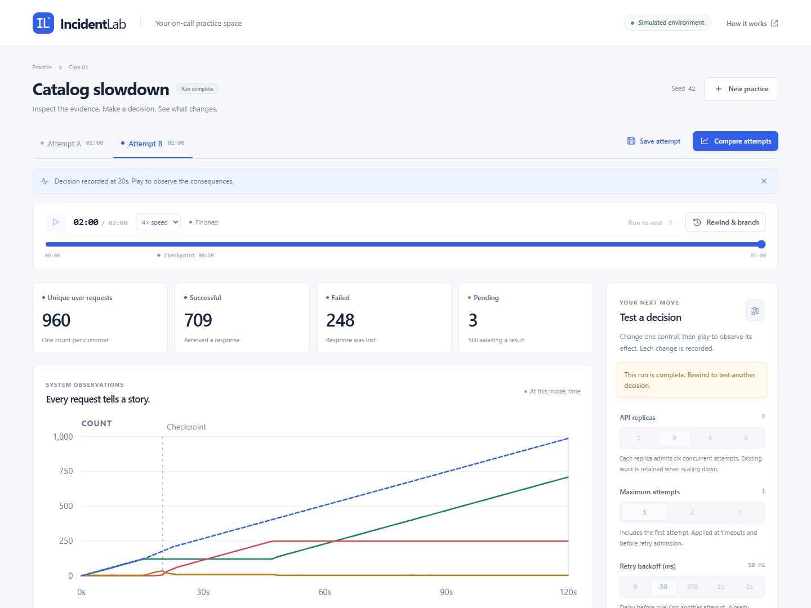
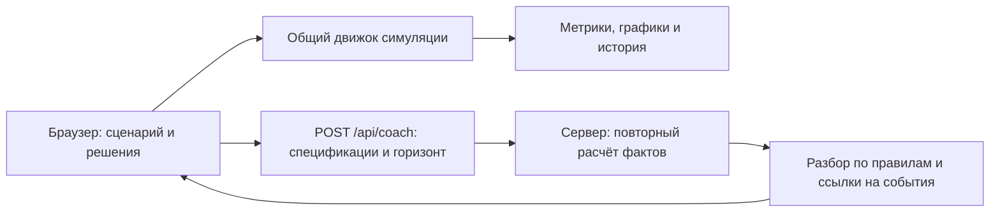

# IncidentLab

**Команда: nexelle.** Браузерный тренажёр расследования инцидентов для разработчиков, которые готовятся к первым дежурствам.

**[Открыть работающую демонстрацию](https://project-mv9nc.vercel.app)** · [Репозиторий](https://github.com/dakonya/businesscup2.0) · [Сценарий показа](docs/demo/runbook.md)

Регистрация не нужна. Интерфейс на русском. В опубликованной версии помощник работает **по правилам**, без внешней модели и запуска GPU.



## 1. Какую проблему решаем

Перед первым дежурством разработчику нужно научиться читать симптомы сбоя, проверять гипотезы и оценивать последствия решения. На рабочем сервисе такие эксперименты могут повлиять на пользователей; изучение готового разбора не позволяет самому пройти цепочку решений.

IncidentLab даёт безопасный учебный кейс: сервис отвечает медленно и с ошибками. Пользователь исследует отдельный запрос, меняет настройку, наблюдает результат и возвращается к той же ситуации для другого решения. Оба решения получают одинаковый поток запросов, поэтому их можно сравнить по вычисленным последствиям.

## 2. Для кого предназначен продукт

Для начинающих разработчиков и инженеров, которые готовятся к первым дежурствам, а также наставников, которым нужен воспроизводимый пример для совместного разбора.

В этой версии проверена работа приложения и сценария демонстрации. Эффективность обучения, спрос и удержание пользователей пока не измерены. Приложение не выставляет оценку профессиональной готовности.

## 3. Что уже реализовано

- Один законченный кейс **«Замедление каталога»** на 120 секунд модельного времени.
- Запуск, пауза, изменение скорости показа, переход по времени и автоматическая остановка на контрольной точке 00:20.
- Метрики и графики настоящего движка: успешные запросы, ошибки, ожидание, очереди, попытки обращения к БД и повторы.
- Фильтр и поиск запросов, постраничный список и полная история событий выбранного запроса.
- Изменение числа реплик API, максимума попыток и задержки повтора с записью времени в журнал решений.
- Сохранение A и независимая B из той же контрольной точки; сравнение при одинаковых нагрузке и горизонте.
- Серверный разбор по правилам со ссылками на реальные события нужной ветки.
- Восстановление попыток после перезагрузки той же вкладки и независимые снимки в разных вкладках.
- Интерфейс для широкого экрана и мобильной ширины 360 пикселей.

Вторая задача, аккаунты, оплата и подключение рабочей инфраструктуры в эту версию не входят.

## 4. Что вводит пользователь и что получает

Новая практика использует **сид 42** — начальное число для воспроизводимой нагрузки. Пользователь выбирает момент просмотра и меняет допустимые настройки. В журнале сохраняются тип действия, значение и модельное время.

| Настройка | Доступные значения |
| --- | --- |
| Реплики API | 1, 2, 4, 8 |
| Максимум попыток, включая первую | 1, 2, 3 |
| Задержка повтора | 0, 50, 250, 1000, 2000 мс |

Вход движка — `RunSpec`: сценарий, сид и упорядоченный журнал действий; отдельно задаётся горизонт расчёта. Выход — `RunView`: исходы запросов, метрики, временные ряды и события. `compareRuns` рассчитывает обе ветки на одном горизонте и возвращает разницу B − A.

Для разбора клиент отправляет на `POST /api/coach` спецификации прогонов и горизонт. **Сервер повторно вычисляет факты движком**, а не доверяет присланным клиентом метрикам. Помощник возвращает объяснение, следующий эксперимент и ссылки на события с пространствами имён `primary:` и `comparison:`.

## 5. Как устроено приложение



| Часть | Реализация |
| --- | --- |
| Интерфейс | `src/app`, `src/components`, `src/lib/client`; главная страница открывает `IncidentLab` |
| Общий контракт | [src/lib/contracts.ts](src/lib/contracts.ts), версия 1 |
| Движок | `src/lib/sim`: `getScenarios`, `simulateRun`, `compareRuns`, `forkRun` |
| Сервер | `src/app/api`, `src/lib/server`: валидация, пересчёт фактов, помощник и ограничения запросов |
| Сохранение | Сценарий, сид, журнал и курсор в браузере; полная история событий в хранилище не записывается |
| Размещение | Один Next.js-проект на Vercel с серверными API-маршрутами |

Симуляция воспроизводится в браузере и на сервере одним чистым TypeScript-движком. Вычисления не выполняются на каждом кадре анимации; список запросов разбит на страницы, события отбираются для выбранного запроса.

## 6. Технологии и роль ИИ

Версии закреплены в `package.json` и `package-lock.json`: **Node.js 24**, Next.js **16.4.6**, React **19.3.1**, TypeScript **7.0.2**, Zod **4.6.7**, Vitest **5.1.0**. Для значков используется `lucide-react`. Браузерные проверки выполняются внешней установкой Playwright без добавления зависимости приложению.

Основные результаты всегда рассчитывает движок. **ИИ не управляет симуляцией и не генерирует значения графиков.** В текущей опубликованной версии сервер использует `INCIDENTLAB_COACH_MODE=rules`: ответ имеет `source: "rules"` и подпись **«Разбор по правилам»**. Если параметр не задан, действует тот же режим.

Также реализован необязательный серверный адаптер NVIDIA. Для него нужно явно выбрать `INCIDENTLAB_COACH_MODE=nvidia` и настроить серверные переменные из [.env.example](.env.example). Реальный ответ модели после проверки формата и ссылок получает `source: "nvidia"` и подпись **«Разбор ИИ»**; при ошибке или таймауте сохраняется честный разбор по правилам с предупреждением.

Отдельно проверялся настоящий inference открытой модели **NVIDIA Nemotron Nano 9B v2** на существующей машине Brev. Однако структурно корректные ответы содержали смысловые ошибки, поэтому этот вариант остаётся экспериментальным. GPU после проверки остановлен; опубликованное демо его не использует. Проверка подписи `nvidia` подставным ответом в браузерном тесте не является проверкой модели.

Ключи доступны только серверу: они не входят в `NEXT_PUBLIC_*`, клиентский код или сохранения. Детали подготовленного варианта и его ограничений — в [документации Brev](docs/engineering/brev.md).

## 7. Откуда берутся данные

Все запросы и события **синтетические**. Внешний набор данных, пользовательские логи и рабочая инфраструктура не используются. Движок моделирует поступление запросов, очереди API и БД, время обработки, таймауты и повторы.

В этом сценарии за 120 секунд поступают 960 уникальных запросов. Сид определяет индивидуальные смещения времени и длительность обработки; одинаковый сид сохраняет одинаковую внешнюю нагрузку для A и B. Решения меняют параметры модели, а не подставляют готовые числа успехов.

Настоящая база данных, брокер очередей, Docker или VM для обычной тренировки не нужны. Проверяемые допущения и порядок событий описаны в [модели симуляции](docs/engineering/model.md).

## 8. Как запустить локально

Нужны **Node.js 24 LTS** и npm. Версию Node также задаёт `.nvmrc`.

```sh
git clone https://github.com/dakonya/businesscup2.0.git
cd businesscup2.0
git switch main
node --version
npm ci
npm run dev
```

Открой [localhost:3000](http://localhost:3000). Для обычного запуска файл `.env` не требуется: помощник по умолчанию работает по правилам. Существующие секреты и настройки провайдера менять не нужно.

Чтобы явно зафиксировать этот режим, в Bash можно запустить:

```sh
INCIDENTLAB_COACH_MODE=rules npm run dev
```

В PowerShell:

```powershell
$env:INCIDENTLAB_COACH_MODE = "rules"
npm run dev
```

Для запуска готовой сборки вместо сервера разработки:

```sh
npm run build
npm start
```

### Опубликованная версия и API

Работающее приложение: **[https://project-mv9nc.vercel.app](https://project-mv9nc.vercel.app)**. Сайт и API проверены без регистрации, авторизационных заголовков и обхода защиты размещения. Полный браузерный сценарий пройден на опубликованной версии в режиме правил.

- `GET /api/health` — состояние приложения и версия контракта.
- `POST /api/coach` — разбор спецификаций прогонов; формат тела описан в [API](docs/engineering/api.md).

В режиме правил `coachConfigured: false` в `/api/health` — **ожидаемый результат**: поле описывает включённую конфигурацию NVIDIA, а разбор по правилам доступен и без неё. Наличие конфигурации само по себе также не доказывает доступность модели или точность её текста.

Для собственного размещения нужен сервер с поддержкой Next.js: статический экспорт не обслуживает эти API. В репозитории есть `vercel.json` и `.vercelignore`; необязательные секреты задаются в серверном окружении хостинга.

## 9. Что показать жюри за 60–90 секунд

1. Нажми **«Начать практику»**. При скорости 4× прогон сам остановится на **00:20** примерно через пять секунд.
2. Выбери **«Ошибки»**, открой **«Подробнее»** у запроса и посмотри его события. Время на паузе не меняется.
3. Ровно на **00:20** установи **4 реплики API** и нажми **«До конца»**.
4. Нажми **«Сохранить попытку»**. Это A; её решения и курсор сохраняются в браузере.
5. Нажми **«Новая попытка с 00:20»**. Для B выбери **максимум 1 попытку**, затем **«До конца»**. Действие A на контрольной точке в B не переносится.
6. Нажми **«Сравнить попытки»**, затем **«Разобрать сравнение»**. Покажи общий горизонт 120 секунд, источник **«Разбор по правилам»** и ссылку на событие нужной ветки.
7. Перезагрузи страницу и нажми **«Продолжить практику»**: попытки и положение времени восстановятся.

Ожидаемые вычисленные результаты для этого эксперимента:

| Показатель | A: 4 реплики API | B: максимум 1 попытка | B − A |
| --- | ---: | ---: | ---: |
| Уникальные запросы | 960 | 960 | 0 |
| Успешные | 120 | 709 | +589 |
| С ошибкой | 800 | 248 | −552 |
| В ожидании | 40 | 3 | −37 |
| Попытки обращения к БД | 2588 | 987 | −1601 |
| p95 успешных ответов, мс | 394 | 397 | +3 |

**Ожидание не считается ошибкой.** У B остаются 248 ошибок и 3 ожидающих запроса. p95 относится только к успешным ответам, поэтому его нужно читать вместе с остальными исходами. Полный порядок показа — в [сценарии демонстрации](docs/demo/runbook.md).

## 10. Как проверить результат

```sh
npm run typecheck
npm test
npm run demo
npm run build
```

На Node.js 24 пройдены установка `npm ci`, проверка типов, **137 тестов в 8 файлах**, воспроизводимое демо и сборка. Тесты проверяют движок, API, ошибки и таймауты, ветвление, контракт и сохранения. `npm run demo` самостоятельно рассчитывает приведённый выше A/B; внешняя модель ему не нужна.

Существующий `tests/ui/browser-flow.mjs` проверяет полный проход, перезагрузку, независимость вкладок, повреждённое сохранение, ошибки и устаревшие ответы помощника. Его запуск требует внешнего Playwright и доступного браузера; настройка описана в [сценарии демонстрации](docs/demo/runbook.md).

На опубликованном сайте проверены широкий экран **1440 px** и мобильная ширина **360 px**. Переполнения страницы по горизонтали нет; широкие таблицы и графики прокручиваются внутри своих областей. В чистой браузерной сессии ошибок JavaScript, ошибок консоли и неуспешных запросов не обнаружено.

Команды `npm run smoke` и `npm run smoke:coach` предназначены для отдельной проверки **реальной модели**, требуют её явного подключения и не нужны для проверки демо в режиме правил.

## 11. Ограничения и дальнейшая работа

- Пока доступен один ограниченный учебный кейс. Модель упрощает инфраструктуру: результат нельзя переносить на рабочий сервис как универсальную рекомендацию.
- Достижение конца модельного времени не означает, что все запросы завершились; оставшиеся запросы явно показываются как ожидающие.
- Сохранения локальны для браузера и вкладки: аккаунтов, серверной базы попыток и синхронизации между устройствами нет.
- Экспериментальный NVIDIA-разбор требует улучшения смысловой точности и отдельной проверки. Текущий рабочий путь использует правила.
- Нет подтверждённых результатов исследования пользователей или измеренного влияния на обучение; такую проверку ещё предстоит провести.
- Проверка ширины 360 px выполнена в браузере и не заменяет проверку на физическом телефоне или проекторе.

Следующие шаги — проверить учебную ценность с пользователями и повысить точность необязательного ИИ-разбора, сохранив воспроизводимость и проверяемые ссылки на события.

Дополнительные материалы: [контракт и передача между частями проекта](docs/engineering/handoff.md), [интеграционные проверки](docs/engineering/integration-ru.md), [размещение](docs/engineering/operations.md), [инженерный отчёт](docs/engineering/report-ru.md). Часть инженерных документов фиксирует исторические этапы, включая прежний отказ размещения и проверки до интеграции; текущий публичный адрес и режим демо указаны выше.
